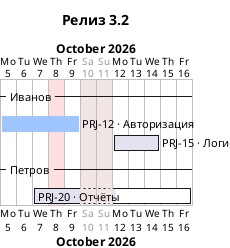
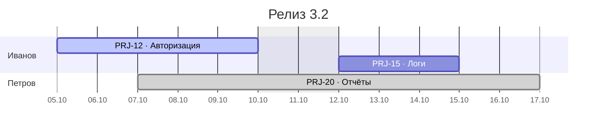

# План: приложение для диаграмм Ганта на основе задач Jira

## 1. Цель и рамки

Веб-приложение, в котором можно:

1. Подключить Jira (URL, токен пользователя, пространство — ключ проекта Jira).
2. Выбрать один или несколько Epic и загрузить их дочерние задачи в локальную БД.
   Для каждой задачи сохраняются: ключ (номер), оценка времени (Original Estimate),
   ожидаемое начало, ожидаемое окончание, исполнитель.
3. Создавать локальные **проекты** и привязывать к ним задачи.
4. Видеть проект как диаграмму Ганта, где строки — участники проекта:
   - участник добавляется кнопкой **«+»** из списка уже синхронизированных пользователей Jira;
   - справа находится список задач проекта (скрывается и показывается кнопкой);
   - задачу из списка перетаскивают на строку участника — так она назначается ему и попадает на шкалу;
   - начало и конец задачи меняются мышкой: перетаскивание полосы целиком сдвигает её,
     перетаскивание левого или правого края меняет длительность;
   - кнопка **«Сохранить»** записывает все изменения диаграммы разом в локальную БД.
5. Выбрать исполнителя и посмотреть всю его нагрузку по всем проектам.
6. Экспортировать диаграмму проекта или нагрузку исполнителя в текст **PlantUML** или **Mermaid**.

### Зафиксированные условия
- **Jira Server / Data Center**, развёрнутый внутри компании. Cloud не поддерживается.
- **Этап 1: Jira только читается.** Все правки (даты, исполнитель) сохраняются только в локальную БД.
  Запись в Jira — отдельный этап 2 (раздел 12), модель данных готовится к нему заранее.
- **Один пользователь**, без авторизации в приложении. Приложение запускается локально или
  на внутреннем сервере; доступ к нему ограничивается сетью.

### Допущения (нужно подтвердить, см. раздел 14)
- изменение длительности полосы **не** меняет Original Estimate — меняются только даты;
- шаг шкалы — один день (поля дат в Jira содержат только дату, без времени);
- рабочие дни — Пн–Пт, без производственного календаря.

---

## 2. Стек

| Слой | Технологии |
|---|---|
| Backend | .NET 10, ASP.NET Core Web API (контроллеры или Minimal API), EF Core 10, Npgsql |
| БД | PostgreSQL 16+ (локально в docker-compose) |
| Интеграция | Typed `HttpClient` + `Microsoft.Extensions.Http.Resilience` (повторы при 429 и 5xx) |
| Секреты | ASP.NET Core Data Protection: токен Jira хранится в БД в зашифрованном виде, ключи шифрования — в папке на диске |
| API-контракт | `Microsoft.AspNetCore.OpenApi` → генерация TS-типов через `openapi-typescript` |
| Frontend | React 19 + TypeScript + Vite, React Router, TanStack Query (данные с сервера), Zustand (черновик правок диаграммы, undo/redo), date-fns, `@dnd-kit/core` (перенос из списка на диаграмму), UI-кит Mantine или shadcn/ui |
| Тесты | xUnit + Testcontainers (PostgreSQL) + WireMock.Net (заглушка Jira); Vitest + Testing Library; Playwright для e2e drag-and-drop |

### Почему диаграмма Ганта пишется своя, а не берётся библиотека
Нужна **ресурсная** диаграмма (строки — люди, а не задачи), перенос задач из внешней боковой
панели, переназначение перетаскиванием между строками и единый черновик правок с массовым
сохранением. Из готовых библиотек:
- `frappe-gantt` и `gantt-task-react` строят строки по задачам;
- `dhtmlx-gantt` распространяется под GPL или за деньги;
- `react-calendar-timeline` слабо поддерживается.

Собственная реализация на CSS Grid, абсолютном позиционировании и Pointer Events займёт
~1–1.5k строк и даст полный контроль над поведением.

---

## 3. Интеграция с Jira Server (только чтение)

### 3.1 Подключение
Параметры подключения (`JiraConnection`):
- `BaseUrl` — например, `https://jira.company.local`;
- `Token` — Personal Access Token, передаётся в заголовке `Authorization: Bearer <PAT>`.
  PAT доступен начиная с Jira 8.14. Если версия старше, нужен запасной вариант — Basic-авторизация
  логином и паролем (поддержать, только если понадобится);
- `ProjectKey` — пространство (ключ проекта Jira);
- сопоставление полей (обязательно: в Jira нет стандартного поля «дата начала»):
  - `StartDateFieldId` — `customfield_XXXXX` («Start date», «Target start» или своё поле);
  - `EndDateFieldId` — по умолчанию `duedate`, иначе «Target end»;
  - оценка — `timeoriginalestimate` (в секундах).

Проверка подключения: `GET /rest/api/2/myself`; версия Jira — `GET /rest/api/2/serverInfo`.
Список полей для экрана сопоставления: `GET /rest/api/2/field`.
Приложение заранее подставляет вероятные поля по названиям `Start date`, `Target start`, `Target end`.

**Особенности внутренней сети:**
- если Jira работает по HTTPS с сертификатом внутреннего центра сертификации, этот корневой
  сертификат нужно добавить в доверенные на машине (или в контейнере), где работает API.
  Отключать проверку сертификата можно только опциональным флагом для разработки;
- при необходимости настраивается корпоративный прокси (`HttpClientHandler.Proxy`, переменная `HTTPS_PROXY`).

### 3.2 Клиент
```
IJiraReader                                  // этап 1
  GetServerInfoAsync()
  GetMyselfAsync()
  GetFieldsAsync()
  SearchEpicsAsync(projectKey, text)
  GetEpicChildrenAsync(epicKey, fields)      // с пагинацией
  GetAssignableUsersAsync(projectKey)

IJiraWriter                                  // этап 2, сейчас не реализуется
  GetIssuesUpdatedAsync(keys[])
  UpdateIssueAsync(key, start, end)
  AssignIssueAsync(key, userName)
```
Используемые запросы REST API v2:

| Действие | Запрос |
|---|---|
| Поиск | `POST /rest/api/2/search` с `jql`, `fields`, `startAt`, `maxResults` (пагинация, пока `startAt < total`) |
| Эпики пространства | JQL `project = KEY AND issuetype = Epic ORDER BY created DESC` (+ `AND summary ~ "text*"`) |
| Задачи эпика | JQL `"Epic Link" = EPIC-1` |
| Пользователи | `GET /rest/api/2/user/assignable/search?project=KEY&username=&maxResults=` |
| Идентификатор пользователя | `name` (логин) и `key` |

### 3.3 Импорт (Jira → БД)
`POST /api/connections/{id}/import { epicKeys: [], projectId?: guid }`
1. Для каждого эпика загрузить дочерние задачи, запросив только нужные поля:
   `summary, status, assignee, timeoriginalestimate, duedate, <startField>, <endField>, updated`.
2. Сделать upsert пользователей (`JiraUser`) по исполнителям, затем upsert эпиков и задач по `(ConnectionId, Key)`.
3. Записать значения из Jira в **снимок Jira** (`Jira*`-поля задачи, раздел 4).
   Плановые значения (`Plan*`) заполнить из снимка, только если задача новая или ещё не правилась локально.
4. Если передан `projectId`, привязать задачи к проекту.
5. Вернуть сводку: сколько задач создано, обновлено и пропущено, и у скольких локальный план отличается от Jira.

Пользователей можно дополнительно синхронизировать отдельной кнопкой «Обновить пользователей»
через `/user/assignable/search`. Так в списке «+» появятся люди, у которых пока нет задач.

Повторная синхронизация проекта (`POST /api/projects/{id}/sync`) заново загружает эпики проекта.
**Локальные правки не затираются**: обновляется только снимок Jira. Если план отличается от Jira,
на полосе показывается значок «отличается от Jira» с подсказкой, что именно отличается.
Задачу можно сбросить к значениям Jira действием «Сбросить к Jira».

### 3.4 Массовое сохранение (только локальная БД)
1. Клиент отправляет `PUT /api/projects/{id}/gantt` со списком изменений:
   `[{ issueId, startDate, endDate, assigneeId, version }]`.
2. Сервер проверяет данные (`EndDate >= StartDate`, исполнитель является участником проекта),
   затем в одной транзакции обновляет `Plan*`-поля и ставит `IsLocallyModified = true`.
3. Оптимистичная блокировка по `xmin` защищает от перезаписи, если диаграмма открыта
   в двух вкладках. В случае конфликта возвращается 409 со списком задач, а клиент предлагает перезагрузить данные.
4. Сохранение всё или ничего: если хоть одна правка не прошла проверку, ничего не записывается.
   Ответ указывает, какие задачи и почему не прошли.

Jira на этом этапе не вызывается.

---

## 4. Модель данных (EF Core, PostgreSQL)

```
JiraConnection
  Id, Name, BaseUrl, EncryptedToken, ProjectKey,
  StartDateFieldId, EndDateFieldId, HoursPerDay (=8), CreatedAt

JiraUser
  Id, ConnectionId → JiraConnection, Name (логин), JiraKey,
  DisplayName, Email?, AvatarUrl?, IsActive
  UNIQUE (ConnectionId, Name)

Epic
  Id, ConnectionId, Key, Summary, LastSyncedAt
  UNIQUE (ConnectionId, Key)

Issue
  Id, ConnectionId, EpicId?, Key, Summary, Status, OriginalEstimateSeconds?,
  -- снимок Jira (обновляется только импортом)
  JiraStartDate?, JiraEndDate?, JiraAssigneeId? → JiraUser, JiraUpdatedAt, LastSyncedAt,
  -- локальный план (редактируется на диаграмме)
  PlanStartDate?, PlanEndDate?, PlanAssigneeId? → JiraUser,
  IsLocallyModified, LocalModifiedAt?,
  xmin (concurrency token)
  UNIQUE (ConnectionId, Key)

Project
  Id, Name, Description?, ConnectionId, CreatedAt

ProjectEpic   (ProjectId, EpicId)           — какие эпики пересинхронизировать
ProjectIssue  (ProjectId, IssueId)          — задачи проекта
ProjectMember (ProjectId, JiraUserId, SortOrder) — строки диаграммы
```

Решения по модели:
- **Снимок Jira и план хранятся раздельно.** Пересинхронизация не теряет локальные правки, а на этапе 2
  отправка в Jira — это перенос `Plan*` → Jira для задач с `IsLocallyModified`.
- `Issue` хранится один раз, а с проектами связан через `ProjectIssue`. Поэтому нагрузка
  исполнителя по всем проектам считается без дублей.
- Даты хранятся как `DateOnly` (тип `date` в PostgreSQL). Конец периода включительный, как в Jira.
- Токен шифруется через `IDataProtector` и в API никогда не возвращается (только `hasToken: true`).

---

## 5. REST API (backend)

```
# Подключения
GET    /api/connections
POST   /api/connections
PUT    /api/connections/{id}
DELETE /api/connections/{id}
POST   /api/connections/{id}/test                — myself + serverInfo
GET    /api/connections/{id}/fields              — для сопоставления полей
GET    /api/connections/{id}/epics?search=
POST   /api/connections/{id}/import              — { epicKeys, projectId? }
POST   /api/connections/{id}/users/sync

# Пользователи
GET    /api/users?connectionId=&search=
GET    /api/users/{id}/workload?from=&to=        — нагрузка

# Проекты
GET    /api/projects
POST   /api/projects
GET    /api/projects/{id}
PUT    /api/projects/{id}
DELETE /api/projects/{id}
POST   /api/projects/{id}/epics                  — привязать эпики (и импортировать)
POST   /api/projects/{id}/issues                 — привязать отдельные задачи
DELETE /api/projects/{id}/issues/{issueId}
POST   /api/projects/{id}/members                — { jiraUserId } (кнопка «+»)
DELETE /api/projects/{id}/members/{userId}
PUT    /api/projects/{id}/members/order
POST   /api/projects/{id}/sync

# Диаграмма
GET    /api/projects/{id}/gantt                  — { members[], issues[], range }
PUT    /api/projects/{id}/gantt                  — массовое сохранение в БД (раздел 3.4)
POST   /api/issues/{id}/reset-to-jira            — сбросить план к снимку Jira

# Экспорт (раздел 9)
GET    /api/projects/{id}/export?format=plantuml|mermaid&groupBy=member|epic&from=&to=
GET    /api/users/{id}/workload/export?format=plantuml|mermaid&from=&to=
```

Ошибки возвращаются в формате `ProblemDetails`, валидация — через FluentValidation или DataAnnotations.
В `IssueDto` есть плановые значения, значения Jira и флаг `differsFromJira`.

---

## 6. Структура решения

```
/backend
  GanttDiagram.sln
  src/GanttDiagram.Api            — контроллеры, DI, OpenAPI, CORS
  src/GanttDiagram.Application    — сервисы: ImportService, GanttService, WorkloadService, Export/*, DTO
  src/GanttDiagram.Infrastructure — DbContext, конфигурации, миграции, JiraServerClient, DataProtection
  src/GanttDiagram.Domain         — сущности, enum'ы, расчёт рабочих дней
  tests/GanttDiagram.Tests        — unit и integration (Testcontainers + WireMock.Net)
/frontend
  src/api            — сгенерированные типы и хуки TanStack Query
  src/pages          — Connections, Projects, ProjectGantt, Workload
  src/features/gantt — компонент диаграммы (раздел 7)
  src/shared         — UI, утилиты дат
docker-compose.yml   — postgres (+ при желании api и web)
```

---

## 7. Экран диаграммы Ганта (основная часть frontend)

### 7.1 Макет
```
┌──────────────────────────────────────────────────────────────────────────────┐
│ Проект «Релиз 3.2»  [День|Неделя|Месяц] [Сегодня] ↶ ↷  [Экспорт ▾] [Отменить] [Сохранить (5)] │
├───────────────┬──────────────────────────────────────────┬───────────────────┤
│ Участники     │ окт 2026  | 5 6 7 8 9 | 12 13 14 …         │ Задачи      [⟩] │
├───────────────┼──────────────────────────────────────────┤ 🔍 поиск          │
│ 👤 Иванов  ⓘ │ [PRJ-12 ████████]   [PRJ-15 ███]            │ Эпик: [все ▾]   │
│               │        [PRJ-14 █████]   ← вторая дорожка  │ ☐ только без дат │
│ 👤 Петров  ⓘ │              [PRJ-20 ██████████] ≠          │ ─────────────── │
│               │                                           │ ⠿ PRJ-31  8ч    │
│ [ + ]         │                                           │ ⠿ PRJ-33  16ч   │
└───────────────┴──────────────────────────────────────────┴───────────────────┘
```
- **Левая колонка** — участники проекта. Кнопка «ⓘ» открывает нагрузку участника.
  Внизу кнопка **«+»**: поповер с поиском по синхронизированным `JiraUser`, которых ещё нет в проекте.
  Строку участника можно удалить через меню, если у него нет задач в этом проекте.
- **Центр** — шкала времени с горизонтальной прокруткой. Выходные затенены, текущий день отмечен вертикальной линией.
  Масштаб День/Неделя/Месяц задаёт ширину одного дня в пикселях: 40, 16 или 4 px.
  Значок `≠` на полосе означает, что план отличается от Jira.
- **Правая панель** — список задач проекта:
  - поиск, фильтр по эпику и переключатель «только незапланированные»
    (без исполнителя-участника или без дат);
  - каждая карточка задачи перетаскивается;
  - кнопка `⟩`/`⟨` сворачивает и разворачивает панель; её состояние хранится в `localStorage`;
  - в свёрнутом виде видна узкая полоса с количеством незапланированных задач.

### 7.2 Состояние (Zustand)
```ts
type GanttDraft = {
  server: Map<IssueId, IssueDto>                // как пришло с сервера
  changes: Map<IssueId, { start?, end?, assigneeId? }>
  history: Change[]; future: Change[]           // undo/redo
  apply(change), undo(), redo(), reset()
  effective(issueId): IssueView                 // server + changes
  dirtyCount
}
```
- Несохранённые полосы отмечаются пунктирной обводкой.
- Кнопка «Сохранить» отправляет `changes` в `PUT /gantt`. После ответа данные проекта
  перезапрашиваются через TanStack Query, черновик очищается.
- Если есть несохранённые изменения, при уходе со страницы срабатывает `beforeunload`
  и блокировка навигации React Router.
- Горячие клавиши: Ctrl+Z / Ctrl+Shift+Z — отмена и повтор, Ctrl+S — сохранить.

### 7.3 Взаимодействие мышью (Pointer Events)
У каждой полосы три зоны: левый край (6 px), тело и правый край.
- `pointerdown` → `setPointerCapture`, запоминаются исходные `start`, `end`, `clientX` и `clientY`.
- `pointermove`:
  - `deltaDays = round((clientX - x0) / dayWidth)` — привязка к дням;
  - тело: `start + d`, `end + d`; при вертикальном смещении подсвечивается целевая строка участника;
  - левый край: `start + d`, но не позже `end`;
  - правый край: `end + d`, но не раньше `start`;
  - во время перетаскивания меняется только локальный `transform` или стиль полосы, без записи в store.
    Так другие строки не перерисовываются. Рядом отображается подсказка с новыми датами и длительностью.
- `pointerup` → в store один раз пишется `apply({ issueId, start, end, assigneeId })`.
- `Esc` во время перетаскивания отменяет действие.
- Если курсор у края видимой области, шкала автоматически прокручивается.

### 7.4 Перенос задачи из списка (dnd-kit)
- `DndContext` охватывает и шкалу, и правую панель. Каждая строка участника — `droppable`.
- При отпускании дата вычисляется по `x` указателя относительно шкалы (с учётом `scrollLeft`), участник — по строке.
  - Если у задачи уже есть даты, длительность сохраняется, а начало переносится в точку отпускания.
  - Если дат нет: `start` = день отпускания,
    `end = addWorkingDays(start, ceil(estimateHours / hoursPerDay)) - 1`;
    без оценки длительность равна 1 дню.
- Задачу можно перетащить с диаграммы обратно в список. Это действие «снять с плана»:
  убираются исполнитель и даты (для MVP опционально).
- Пока задачу тащат, на шкале показывается полупрозрачная тень будущей полосы.

### 7.5 Отрисовка
- Перекрывающиеся задачи одного участника раскладываются по дорожкам жадным алгоритмом
  (сортировка по `start`, задача кладётся в первую свободную дорожку). Высота строки = число дорожек × 28 px.
- Над каждой строкой идёт тонкая полоса загрузки: часы в день против `HoursPerDay`,
  дни с перегрузкой выделены красным.
- Цвет полосы зависит от эпика или статуса (настраивается). Подпись: `KEY · summary`.
  Во всплывающей подсказке — плановые даты и даты в Jira (если отличаются), оценка, статус и ссылка
  на задачу в Jira (`{BaseUrl}/browse/{Key}`).
- Виртуализация не нужна, пока проект небольшой (десятки участников, сотни задач). Если понадобится — `@tanstack/react-virtual` по строкам.

Утилиты (`dateMath.ts`, `lanes.ts`, `workload.ts`) пишутся как чистые функции с unit-тестами.

---

## 8. Экран нагрузки исполнителя

`/workload/:userId` (переход из «ⓘ» на диаграмме или из меню «Исполнители»):
- выбор исполнителя (поиск по `JiraUser`) и периода;
- `GET /api/users/{id}/workload?from&to` возвращает задачи, где `PlanAssigneeId` равен этому человеку,
  **по всем проектам** (и задачи без проекта из импортированных эпиков) с проектом, эпиком, плановыми датами и оценкой;
- отображение:
  1. та же шкала времени: строки — проекты, полосы — задачи (тот же компонент в режиме `readOnly`; редактирование можно включить позже);
  2. гистограмма по дням: `Σ (estimate / рабочие дни задачи)` против `HoursPerDay`,
     с перегрузкой красным; для гистограммы можно взять Recharts или SVG вручную;
  3. итоги: всего часов за период, процент загрузки, задачи без дат или без оценки.

---

## 9. Экспорт в PlantUML и Mermaid

Экспортировать можно диаграмму проекта или нагрузку исполнителя. Результат — текст, который
вставляется в Confluence, GitLab/Bitbucket, Markdown-документацию или wiki.

### 9.1 Где генерируется
Текст собирается **на backend**: одна и та же логика нужна и для проекта, и для нагрузки, и её удобно
покрыть тестами. Экспорт идёт из сохранённых данных (плановых значений `Plan*`). Если на диаграмме
есть несохранённые правки, диалог экспорта предлагает сначала сохранить их.

```
GanttExportModel                      // общая модель, не зависит от формата
  Title, From, To, Today, ClosedDays[] (выходные и праздники)
  Sections[]: { Name, Tasks[] }       // секция = участник, эпик или проект
  Task: { Id, Key, Summary, Start, End, Status, StatusCategory, EpicKey, AssigneeName, JiraUrl }
  Unscheduled[]: { Key, Summary }     // задачи без дат — в комментарии

IGanttExporter { string Format; string FileExtension; string Export(GanttExportModel, ExportOptions) }
  PlantUmlGanttExporter   → .puml
  MermaidGanttExporter    → .mmd
```
Новый формат добавляется ещё одной реализацией `IGanttExporter`, остальной код не меняется.

### 9.2 Параметры экспорта (`ExportOptions`)
- **формат**: PlantUML или Mermaid;
- **группировка**: по участникам (по умолчанию) или по эпикам; для нагрузки — по проектам;
- **период** `from`–`to`: попадают задачи, которые пересекают период;
- **подпись задачи**: `KEY`, `KEY · summary` (по умолчанию) или `KEY · summary (исполнитель)`;
- **исключать выходные** (по умолчанию да);
- **отмечать сегодняшний день**.

Задачи без дат на шкалу не попадают. Они перечисляются в комментарии в конце файла, чтобы было видно, что их пропустили.

### 9.3 PlantUML

- `Project starts` = минимальная дата начала среди задач (или `from`), секции оформляются как `-- имя --`;
- у каждой задачи есть короткий алиас `[T{n}]`. Так ссылки на неё не зависят от текста названия;
- даты окончания в PlantUML включительные — совпадают с моделью, ничего не пересчитывается;
- цвет полосы зависит от эпика: палитра закреплена за `EpicKey` и совпадает с цветами на диаграмме в приложении;
- статус «Готово» выводится как `is 100% completed`;
- экранирование: `]` и `[` в названиях заменяются на `)` и `(`, переводы строк — на пробел.
  Файл сохраняется в UTF-8 — кириллица в PlantUML работает.

### 9.4 Mermaid

- **В Mermaid дата окончания не включается в задачу**, поэтому при экспорте к `End` прибавляется 1 день.
  Это главное отличие от PlantUML, и его нужно закрыть отдельными тестами;
- категория статуса Jira определяет тег: `done` → `done`, `indeterminate` (в работе) → `active`.
  Тегом `crit` помечаются просроченные задачи (`End < today` и не выполнены);
- идентификаторы задач — `t{n}`;
- экранирование: в названии запрещены `:`, `#` и `;` (они ломают синтаксис), их заменяем на ` -`, `№` и `,`;
- цвет по эпику в Mermaid задать нельзя (только через тему целиком), поэтому эпик можно только добавить в подпись.

### 9.5 Интерфейс
- Кнопка **«Экспорт ▾»** на панели диаграммы и на экране нагрузки открывает диалог:
  - выбор формата и параметров из 9.2;
  - текст результата в поле с моноширинным шрифтом;
  - кнопки **«Копировать»** и **«Скачать»** (`<проект>_<дата>.puml` / `.mmd`).
- **Предпросмотр Mermaid** рисуется прямо в браузере библиотекой `mermaid`. Она тяжёлая, поэтому
  подгружается только при открытии диалога (`import()`).
- **Предпросмотр PlantUML** требует сервера PlantUML. Публичный `plantuml.com` не используется: данные
  задач не должны уходить наружу. Если в компании есть свой PlantUML-сервер, его адрес указывается
  в настройках, и картинка строится по ссылке `{server}/svg/{encoded}` (кодирование — пакет `plantuml-encoder`).
  Если адреса нет, предпросмотр не показывается.

---

## 10. Остальные экраны

- **Подключение к Jira**: форма URL, токен, ключ пространства. Кнопка «Проверить» показывает
  пользователя и версию Jira. Мастер сопоставления полей с выпадающими списками из `/fields`.
- **Проекты**: список и создание. Из карточки проекта запускается диалог «Добавить эпики»:
  поиск эпиков в Jira, мультивыбор, «Импортировать». Импорт показывает прогресс и итоговую сводку.
- **Проект → Задачи**: таблица задач проекта, отвязка задач, ручная пересинхронизация,
  фильтр «отличается от Jira».

---

## 11. Этапы реализации (этап 1 — без записи в Jira)

| # | Этап | Результат |
|---|---|---|
| 0 | Каркас: solution, docker-compose с Postgres, Vite-проект, ESLint/Prettier, `.editorconfig`, генерация TS-типов из OpenAPI | Пустое приложение запускается, frontend обращается к `/api/health` |
| 1 | Домен и БД: сущности, конфигурации EF, первая миграция, CRUD проектов | Проекты создаются и хранятся в Postgres |
| 2 | Jira: подключение, шифрование токена, проверка, сопоставление полей, `JiraServerClient` (чтение) | Подключение к внутренней Jira проверено, поля сопоставлены |
| 3 | Импорт: поиск эпиков, загрузка задач с пагинацией, upsert пользователей и задач (снимок + план), привязка к проекту, пересинхронизация без потери правок | Задачи эпика лежат в БД |
| 4 | API диаграммы: `GET /gantt`, участники («+», удаление, порядок) | Данные для диаграммы готовы |
| 5 | Диаграмма (только чтение): шкала, масштаб, строки участников, дорожки, правая панель с показом и скрытием | Видна диаграмма проекта |
| 6 | Редактирование: перетаскивание и изменение размера полос, перенос между участниками, перенос из списка, черновик, undo/redo | Правки мышью работают локально |
| 7 | Массовое сохранение в БД: `PUT /gantt`, валидация, `xmin`, индикатор «отличается от Jira», «Сбросить к Jira» | Правки сохраняются и переживают пересинхронизацию |
| 8 | Нагрузка исполнителя: endpoint, экран, гистограмма | Видна загрузка человека по всем проектам |
| 9 | Экспорт: `GanttExportModel`, экспортёры PlantUML и Mermaid, endpoints, диалог с копированием, скачиванием и предпросмотром Mermaid | Диаграмма выгружается в `.puml` и `.mmd` |
| 10 | Доводка: обработка ошибок и пустых состояний, e2e-тесты, Dockerfile для api и web | Готовый MVP |

Критичный путь — этапы 2 → 3 → 6 → 7. Этап 5 можно начать параллельно с этапами 2–3 на тестовых данных (seed).

---

## 12. Этап 2 (позже): запись изменений в Jira

Уже заложено в этапе 1: разделение снимка Jira и плана, флаг `IsLocallyModified`, интерфейс `IJiraWriter`.

Что нужно будет добавить:
1. Кнопку «Отправить в Jira» для проекта (отдельно от «Сохранить» или как опцию при сохранении)
   с предпросмотром списка изменений: «PRJ-12: начало 05.10 → 07.10, исполнитель ivanov → petrov».
2. Проверку конфликтов одним запросом: JQL `key in (…)` с полем `updated`. Если поле `updated`
   в Jira новее `JiraUpdatedAt`, задача помечается конфликтом и не записывается.
3. Параллельную запись с ограничением (`SemaphoreSlim(4)`):
   - `PUT /rest/api/2/issue/{key}` с полями дат;
   - `PUT /rest/api/2/issue/{key}/assignee` с `{ "name": "<логин>" }`.

   Пакетного API для разных значений в разных задачах в Jira нет.
4. Статус по каждой задаче — `Synced` / `Failed(error)` / `Conflict`. После успешной записи
   снимок Jira обновляется и `IsLocallyModified` сбрасывается. Неудавшиеся задачи можно отправить повторно.
5. Проверку прав: у владельца токена должны быть права Edit Issues и Assign Issues в проекте,
   а поля дат должны присутствовать на экране редактирования задачи (иначе Jira ответит 400).

---

## 13. Тестирование

- **Unit**: расчёт рабочих дней, длительность по оценке, раскладка по дорожкам, расчёт нагрузки
  (C# и TS), маппинг ответов Jira в сущности, правила «снимок и план» при пересинхронизации.
- **Экспорт**: snapshot-тесты (библиотека `Verify`) — эталонные `.puml` и `.mmd` для фиксированной модели.
  Отдельно проверяются: дата окончания в Mermaid сдвигается на +1 день, а в PlantUML нет;
  экранирование `[ ] : # ;` и переводов строк; кириллица; задачи без дат уходят в комментарий; пустой проект.
  Сгенерированный Mermaid дополнительно проверяется парсером: `mermaid.parse()` в Vitest.
- **Integration (backend)**: Testcontainers с Postgres и WireMock.Net в роли Jira Server. Сценарии:
  импорт с пагинацией; пересинхронизация не затирает локальные правки; сохранение с конфликтом `xmin` → 409;
  валидация «исполнитель не участник проекта».
- **Frontend**: Vitest для store (apply, undo, redo, effective). Playwright: перетаскивание полосы,
  изменение размера за край, перенос задачи из списка на участника, «Сохранить» (API замокан).

---

## 14. Открытые вопросы

1. **Какое поле означает «ожидаемое начало»?** Стандартного поля нет: это `Start date`,
   `Target start` или своё custom-поле. А «ожидаемое окончание» — `Due date` или `Target end`?
   (В приложении поля выбираются при настройке подключения, но нужны значения по умолчанию.)
2. **Какая версия Jira Server?** Personal Access Token доступен с 8.14; если версия старше, нужна Basic-авторизация.
3. **Должно ли изменение длительности полосы менять Original Estimate?** (Сейчас заложено «нет».)
4. **Нужны ли праздники в расчётах** (производственный календарь РФ) или достаточно Пн–Пт?
5. **Может ли одна задача входить в несколько проектов?** Модель это допускает; если не нужно, добавить уникальный индекс на `ProjectIssue.IssueId`.
6. **Есть ли в компании свой PlantUML-сервер** (например, его использует плагин Confluence)?
   Если есть, можно показывать предпросмотр PlantUML прямо в приложении.
